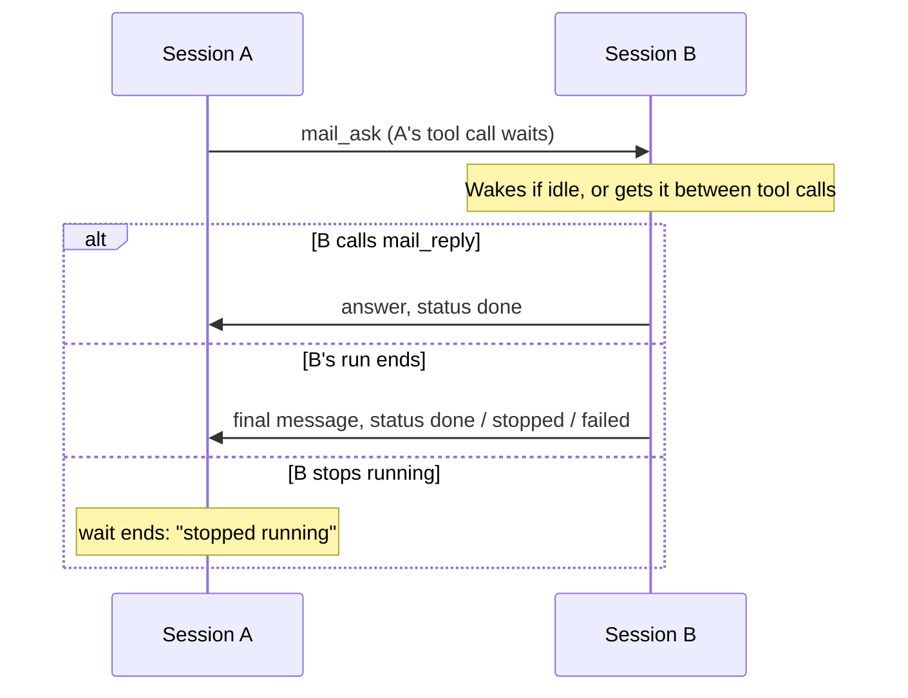

# omp-mail

Messaging between [omp](https://github.com/can1357/oh-my-pi) sessions on one machine.

- **Send** plain text to up to 8 sessions. A running session gets it between tool calls. An idle session wakes up.
- **Offline mail.** A closed session keeps its inbox. Mail waits on disk and wakes the session when it resumes.
- **Receipts.** Each recipient is reported as `delivered` (the text is in its context) or `queued`.
- **Ask and wait.** `mail_ask` blocks until the other session answers. The answer is the tool result, in the same turn.
- **Answers that always come back.** The other session can answer with `mail_reply`. If it does not, its final message of the run is sent back. If it stops running, the wait ends at once.
- **A CLI** for scripts and hooks: `omp-mail send` and `omp-mail ask`.

It is written for omp. It uses only events and APIs that omp fires, so the parts that fail for pi packages on omp do not apply. See [Why another one](#why-another-one).

## Install

```sh
omp plugin install github:paymog/omp-mail
```

Install only one messaging plugin. Two give the model overlapping tools.

## Tools

| Tool | Does |
| --- | --- |
| `mail_list` | Lists sessions: name, address, running or not, idle or working, directory. |
| `mail_send` | `to` (1–8 targets), `message`. Reports `delivered`, `queued`, or `refused` for each target. |
| `mail_ask` | `to`, `message`, optional `timeout_seconds` (default 600). Waits for the answer and returns it. |
| `mail_reply` | `ask_id`, `message`. Answers a question at once. |

omp shows extension tools as `xd://` devices. The model finds them in its device list.

The `/mail` command lists sessions. `/mail <to> <message>` sends a message from you.

## Addressing

A target can be any of these:

- a session name (the `/rename` name, or else the directory name),
- an address (12 hex characters, from `mail_list`),
- a directory path, such as `~/code/api` or `../web`,
- an omp session id.

Prefixes of addresses and session ids work when they are unique and at least 4 characters long. A running session wins over a closed one with the same name. If two running sessions match, the send is refused and the candidates are listed. It never guesses.

An address belongs to a conversation, not to a process. It is a hash of the omp session id, so a resumed session keeps its address.

## Ask and reply



- A question is answered once. The automatic answer covers only questions that entered B's context during that run.
- If the user stops B's run, the answer has status `stopped` and holds the partial text.
- If B closes with questions open, each asker gets status `failed`.
- If A stops waiting (timeout, or the user stops A), a later answer arrives as a normal message.
- If B is not running, the question is queued. Its answer arrives as a message after B resumes.
- A asking B while B waits on A is refused, because both would wait until timeout.

## CLI

```sh
omp-mail list
omp-mail send api,web "Schema changed: users.email is now unique."
echo "long text" | omp-mail send ~/code/api -
omp-mail ask ~/code/api "Are the migrations applied?"   # prints the answer
```

The CLI runs with Bun. After a plugin install it is at `~/.omp/plugins/node_modules/.bin/omp-mail`. `--name` sets the sender name. `ask` exits with code 2 when no answer comes.

## Boundary

Every delivered message says that it came from another session, not from the user. It has no authority. It cannot approve actions, change instructions, or grant permissions. Slash commands in it are inert text.

The mail directory is `0700`. Any process that runs as you can write to it, as with any file you own.

## Limits

- Body: 32 KiB. Send a summary and a file path, not file contents.
- Backlog: 50 unread messages in one inbox. Answers are always accepted.
- Loops: the receiver drops a message that repeats the same text from the same sender within 10 s. It also drops messages from a sender after 8 in 30 s.
- Subagents do not get an address. Only the first session in an omp process registers.
- Same machine only.

## How it works

```
~/.omp/mail/                    0700 (override: OMP_MAIL_DIR)
  sessions/<address>.json       presence: pid, heartbeat, idle/working, name, cwd
  inbox/<address>/<id>.json     one letter per file
```

There is no daemon and no socket. A sender writes a temporary file and renames it into the inbox, so a reader never sees half a letter. The receiver watches its inbox (with a 2 s poll as backup). It puts each letter in context, then deletes the file. The delete is the receipt: `delivered` means the file disappeared within 1.5 s.

Presence is a pid and a heartbeat every 10 s. `running` means the pid exists and the heartbeat is recent. `not responding` means the pid exists but the heartbeat is old. `not running` means the session closed or died.

A clean shutdown marks the session offline and keeps its inbox. A sweep deletes an offline session only after its inbox has been empty for 7 days, or 30 days if mail is still waiting.

## Why another one

Thirty-five pi messaging packages were tested on omp 18.10.1 with two real sessions each. The best ones (pi-post, pi-peer) had durable mail and receipts but no blocking ask. The only one with a blocking ask (pi-session-mail) never sent its automatic answer on omp. It waits for pi's `agent_settled` event, and omp does not fire it.

omp-mail combines the two designs and answers on omp's `agent_end` (skipping ends with `willContinue`). It is built on omp's own extension API (`pi.typebox`, `session_switch`, `message_end`), not on pi's.

Prior art: [pi-post](https://www.npmjs.com/package/pi-post), [pi-peer](https://github.com/shift-labs-ai/pi-peer), and [pi-session-mail](https://github.com/gvanderclay/pi-session-mail). All are MIT.

## Development

```sh
bun install
bun run check          # typecheck and unit tests
bun scripts/e2e.ts     # real omp sessions; spends model tokens
```

`scripts/e2e.ts` runs these scenarios with two real omp sessions: `idle`, `busy`, `resume`, `ask`, `ask-auto`, `ask-dies`, `cli-ask`.
